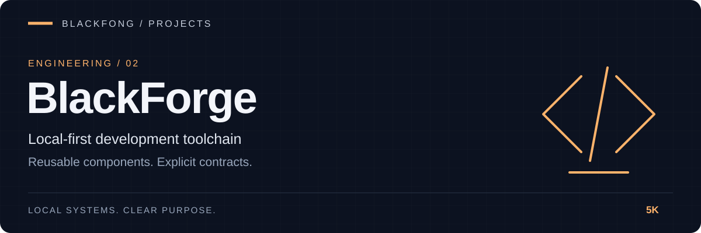

<div align="center">



**Local-first development toolchain.**


[](https://github.com/5K-bit/Blackforge/actions/workflows/ci.yml)

[Installation](#installation) · [Create components](#create-components) · [Validation](#inspect-and-validate-obeos-components) · [Evaluation](#contract-evaluation-suite)

</div>

---

# BlackForge

| Scaffold | Inspect | Validate |
|---|---|---|
| Services, agents, skills and workers | Manifest discovery and environment checks | Component contracts and evaluation suite |

BlackForge is the local-first OBEOS development toolchain. It turns repeatable architecture into reusable, validated component scaffolds so new OBEOS software starts from a known contract instead of copied boilerplate.

## OBEOS component templates

- `obeos-service` — FastAPI service with health/readiness contracts and tests.
- `obeos-agent` — bounded async agent request/result contract.
- `obeos-skill` — load-on-demand Markdown skill contract.
- `obeos-worker` — bounded background job processor.
- `obeos-connector` — external-system integration boundary.
- `obeos-device` — hardware/device adapter boundary.
- `obeos-event-consumer` — explicit event-processing entrypoint.
- `obeos-hud` — thin FastAPI UI/status surface.

General templates remain available: `cli`, `fastapi`, and `python-package`.

Every OBEOS scaffold includes `obeos.manifest.json`, using schema version 1 and the canonical `component_type` field. The manifest is the stable discovery boundary for OBEOS registries, launchers, health tooling, and adapters without coupling generated components to DAISE internals.

## Installation

```bash
pip install -e ".[dev]"
```

## Create components

```bash
blackforge list-templates
blackforge new obeos-service sentinel-bridge
blackforge new obeos-agent research-agent
blackforge new obeos-worker queue-worker
blackforge new obeos-connector telegram-bridge
blackforge new obeos-device mesh-node
blackforge new obeos-event-consumer audit-consumer
blackforge new obeos-hud legion-hud
blackforge new obeos-skill weekly-review
```

The generic command works for every installed template:

```bash
blackforge create TEMPLATE PROJECT_NAME
```

Preview a generation plan without touching disk:

```bash
blackforge create obeos-agent planner-agent --preview
```

BlackForge rejects path traversal and nested project-name paths. Existing destinations are protected unless `--force` is explicitly supplied.

## Inspect and validate OBEOS components

From a generated component:

```bash
blackforge inspect .
blackforge validate obeos.manifest.json
blackforge doctor .
```

`inspect` discovers the nearest manifest by walking parent directories. `validate` checks the OBEOS manifest contract. `doctor` checks the local Python/tooling/component environment.

## Manifest contract

Schema version 1 requires:

- `schema_version`
- `name`
- `component_type`
- `version`
- `entrypoint`

Components can additionally declare interfaces, package name, health/readiness endpoints, and generation metadata.

## Development

```bash
pytest
```

CI tests Python 3.11 and 3.12.

## Contract evaluation suite

`eval/run_eval.py` is a separately runnable evaluation suite, distinct from
`pytest`: for every `obeos-*` template it generates a sample component and
checks that the result actually conforms to the OBEOS manifest contract
(`obeos.manifest.json` validity, `component_type` matching the template,
`blackforge doctor`), not just that it builds. This is a scaffold/contract
conformance check, not a benchmark of agent or model behavior.

```bash
python eval/run_eval.py                                   # all templates
python eval/run_eval.py --templates obeos-service,obeos-worker
python eval/run_eval.py --skip-build                       # skip the wheel build/import check
python eval/run_eval.py --json report.json                 # also write a machine-readable report
```

Exits non-zero if any template fails any check, so it can be run in CI
independently of the regular `pytest` job.

## Source-of-truth policy

`5K-bit/Blackforge` is the canonical BlackForge repository. The `Blackforge` path inside the O.B.E.O.S. repository should reference this repository as a pinned Git submodule rather than maintain an independent copy. Changes belong here first; OBEOS then advances the pinned commit after BlackForge CI passes.

## Terminal identity

`blackforge --version` prints the installed version (source version when running an uninstalled checkout). Help identifies BlackForge as a Blackfong project. Interactive commands display a compact product banner on stderr; automatic banners are suppressed when either output stream is redirected. Use `--no-banner` to suppress it or `--banner` before a subcommand to request it explicitly. `NO_COLOR` and `TERM=dumb` disable banner colors. Command output, exit codes, and operational status labels retain their meaning.
